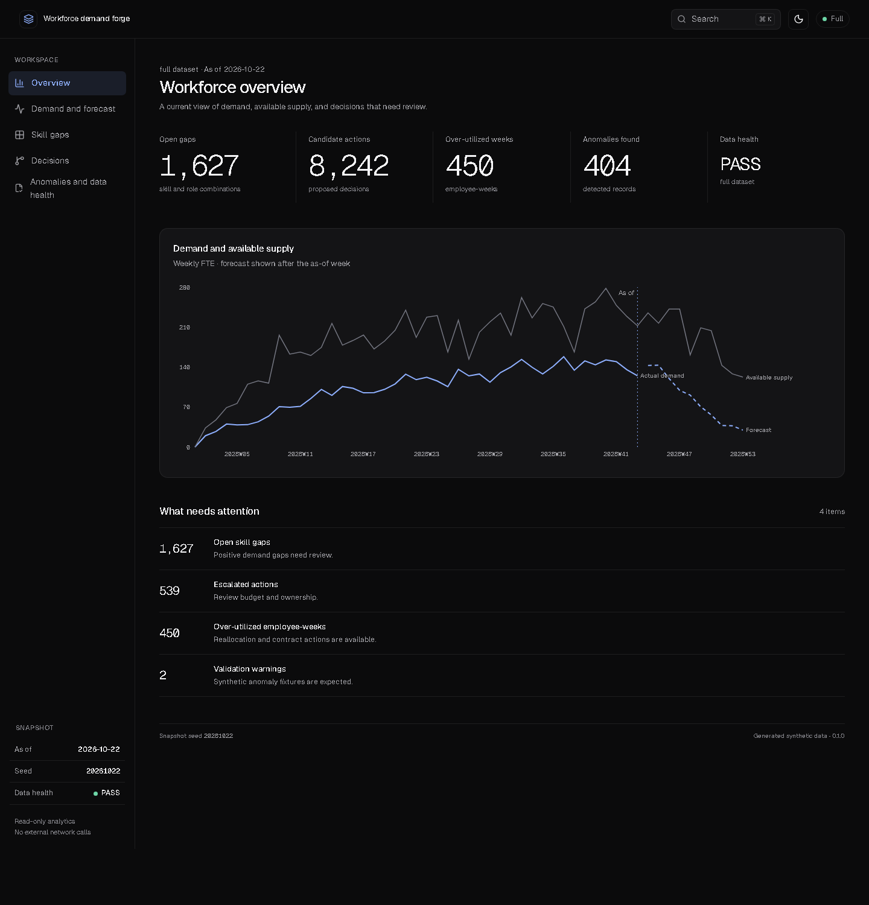
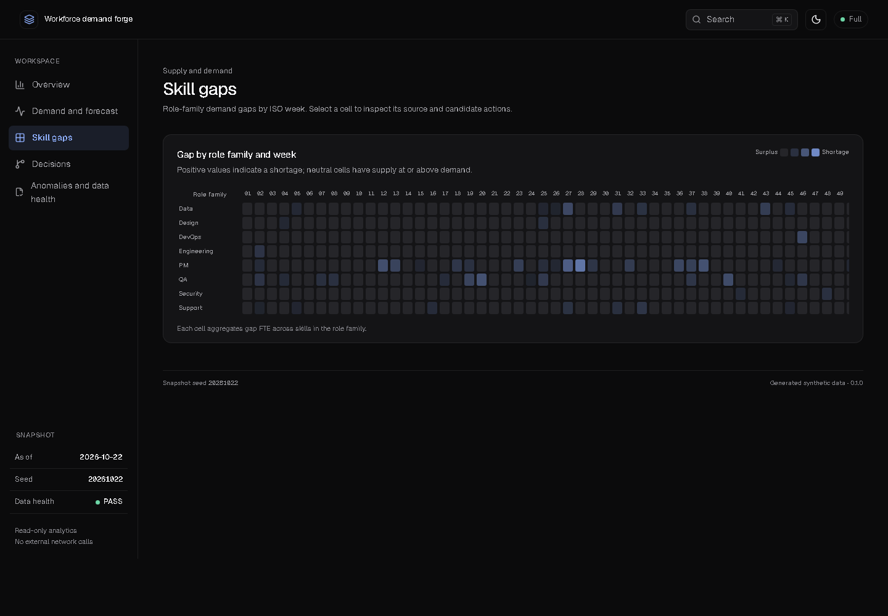
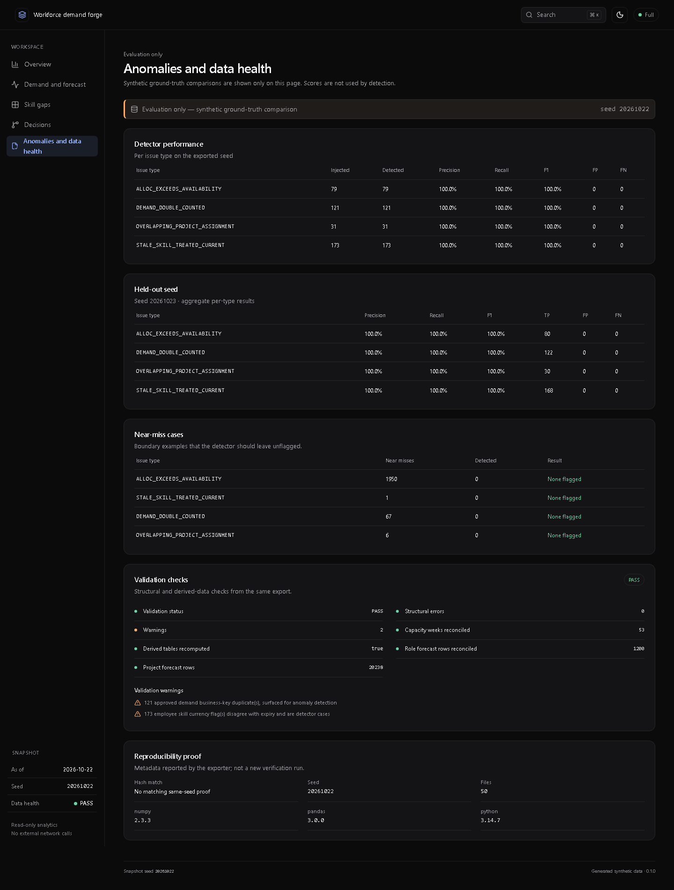

# Workforce Demand Forge

A synthetic data generator for workforce planning, plus everything that checks it. It builds 5,000 employees with skills, 500 projects, weekly demand by role, leave and allocations. From those it works out capacity, utilization, skill gaps and suggested actions (hire, train, re-verify, reallocate, contract). It also plants four kinds of data problems on purpose, writes the answers to a separate file, and has a detector that finds the problems without ever reading that file.

Built for the YottaFlex AI candidate project. The brief is in [docs/PROBLEM.md](docs/PROBLEM.md).

## Run it

You need Python 3.11+ and [uv](https://docs.astral.sh/uv/) (`pip install uv`).

```
uv sync --locked
uv run wdf generate --scale starter --seed 20261022 --out output/starter
uv run wdf validate --input output/starter
uv run wdf detect --input output/starter
uv run wdf evaluate --input output/starter
uv run wdf forecast --input output/starter
```

`generate` clears its output folder, so run `detect` after it to recreate the detection files.

Starter scale is 300 employees. For the full 5,000, use `--scale full --out output/full`. On my Windows machine (Python 3.14) that took about 100 seconds and 830 MiB of memory.

## What you get

CSV and JSON for each of 19 tables (the 10 from the brief plus bridge, leave, event and derived tables), `schema.sql` and `seed.sql`, a SQLite database, a manifest with checksums, role-level and project-level forecasts, and the ground truth in its own `ground_truth/` folder. At full scale that is 57,595 employee-skill rows, 7,535 allocations, 265,000 employee-weeks of availability, 4,389 skill gaps and 8,242 suggested actions.

## How the data is built

1. Master tables first: roles, skills, employees, projects.
2. Transactions on top of valid parent IDs: skills held by each person, demand, leave, allocations, training.
3. Anomalies are planted in the source tables only.
4. Everything derived (availability, utilization, supply, gaps, actions) is calculated afterwards from those sources, so it always reconciles with them.

Each skill gap lists the demand lines and the qualified people it came from. Each suggested action names a rule, an owner and the thresholds it used.

## The four planted problems

| Problem | What it looks like |
|---|---|
| Allocation exceeds availability | One person's allocations add up to more than 100% of that week's available hours |
| Stale skill treated as current | The source flag says Current, but the expiry date has passed |
| Demand double-counted | Two approved demand lines for the same project, role, skill and week |
| Overlapping project assignment | Someone on a dedicated-team project is also allocated somewhere else |

About 2% of eligible rows get each problem (404 at full scale). The data also contains legal look-alikes the detector must leave alone: allocations that add up to exactly 100%, expiry dates exactly on the as-of date, adjacent but non-overlapping allocations, and superseded demand revisions.

## How I checked it

- 35 tests and a clean `ruff` run.
- `tools/independent_check.py` is a second checker written with only the standard library. It imports nothing from the project and recomputes capacity, utilization and gaps from the exported files.
- Generating twice with the same seed gives identical hashes for every file. A different seed changes them. Starter hashes were the same on Python 3.11 and 3.14. Run `uv run wdf repro --scale starter --seed 20261022 --out output/starter-repro` to see it.
- The detector scores 1.000 precision and recall on three seeds. That is a weak claim: the detector and the planted problems follow the same rules. It shows the logic is consistent, not that it would work on real HR data.
- [docs/TRACEABILITY.md](docs/TRACEABILITY.md) maps each line of the brief to the file or test that covers it. [docs/SELF_AUDIT.md](docs/SELF_AUDIT.md) has the commands and output behind the numbers here.

## Forecast

Role-level demand forecasts at full scale, scored by WAPE (lower is better):

| Method | 4 weeks | 8 weeks | 12 weeks |
|---|---:|---:|---:|
| 4-week moving average | 0.578 | 0.570 | 0.574 |
| Pipeline adjusted | 0.374 | 0.528 | 0.653 |
| Pipeline, calibrated on past data | 0.253 | 0.378 | 0.531 |

The calibrated method wins at every horizon, but every method under-forecasts at longer ranges. At project level the moving average is poor (WAPE around 1.8) because project demand comes and goes. Backtests only use data that existed at each forecast date, and a test checks that. More detail is in [docs/VALIDATION_SUMMARY.md](docs/VALIDATION_SUMMARY.md).

## Choices worth explaining

- **Demand is a header plus lines.** The brief's ID `DEM-<project>-2026W01` is one per project and week, but demand is per role and skill, so the lines hang off the header. This is the one deliberate deviation from the brief.
- **The stale flag is stored apart from the expiry date.** That is the only way a skill can be "stale but treated current".
- **Allocation percent is of that week's available hours.** Leave and part-time work shrink the hours, so 100% always means "all the hours this person has".
- **2026 has 53 ISO weeks.** W53 starts on 2026-12-28, so nothing is hardcoded to 52.
- **Two validation warnings are expected.** They report the duplicate demand lines and the flag mismatches that I planted.

## Dashboard

Optional. The Python side does not need Node.

```
uv run wdf export-dashboard --input output/starter
npm ci --prefix dashboard
npm run dev --prefix dashboard
```

You need Node 20.19+ or 22.12+. It is a read-only static site with five pages: overview, demand and forecast, skill gaps, decisions, and anomalies and data health. Click a gap in the heatmap to trace it back to its demand lines and suggested actions. Ground truth is only loaded on the anomalies page and is labelled as evaluation data. Geist fonts are bundled, so nothing is fetched from the internet.







## Limitations

- Everything is synthetic. Do not use it for real workforce decisions.
- Detector scores come from planted rules (see above).
- The "stale skill" problem has one variant: an expired skill flagged Current.
- One active allocation stays on a cancelled project on purpose, to test that exception.
- The skill-gap heatmap needs sideways scrolling to show all 53 weeks, and its shortage colours are pale.
- `npm audit` reports 11 moderate findings in development tools and none in production dependencies.
- GNU Make was not available on my Windows machine, so I ran the equivalent `uv run` commands. The Makefile and the GitHub Actions workflow are there as a convenience, and the commands above are the ones I tested.
- NumPy's random streams are only guaranteed stable for a pinned version, so the versions are pinned.

## Where things are

- `wdf/`: generator, validators, detector, forecast, CLI
- `config/`: calendar, rates, thresholds, scales
- `tests/` and `tools/`: tests and the independent checker
- `docs/`: data dictionary, ERD, assumptions, design decisions, traceability, audit
- `dashboard/`: the optional dashboard
- `output/starter/`: committed sample output

## AI use

Most of the code was written by AI coding agents from prompts that I drafted with an AI chat assistant. [docs/AI_USAGE.md](docs/AI_USAGE.md) says what I checked myself, and [docs/PROMPTS.md](docs/PROMPTS.md) has the prompts.

https://github.com/user-attachments/assets/48046c21-c117-4409-9fd3-9609f435dca0


