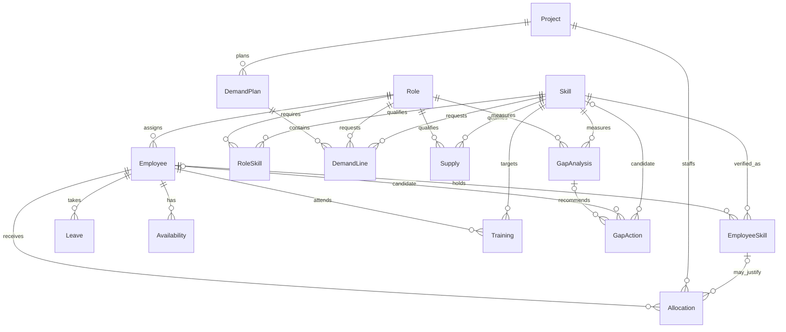
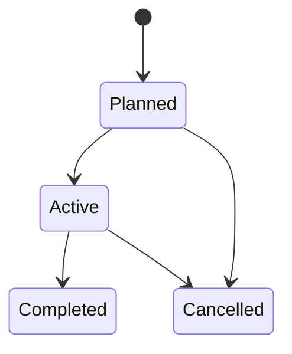

# Entity relationship diagram

`RoleSkill` and `EmployeeSkill` are bridge entities for the Role↔Skill and Employee↔Skill many-to-many relationships. Project-week headers have one `DemandPlan` per project and ISO week; each header has one or more role/skill `DemandLine` children. A demand line's `supersedes_line_id` is an optional self-reference; revisions are append-only.

Every `Availability` and `Utilization` row is effective for one employee-week. Allocation, leave, project, training, and lifecycle records carry effective dates. `LifecycleEvent` is append-only and polymorphically references Employee, Project, Allocation, Training, or DemandLine; current state is the final event in effective-date order. SQL cannot express that polymorphic relation as a single foreign key, so the validator checks its referential and state consistency.

Forecasts are derived CSV outputs rather than SQLite entities: `forecast.csv` is keyed by role/week/method, and `forecast_project.csv` adds Project to that key. Project-level rows are allocated using only historical or origin-visible project demand; their FTE totals reconcile to the corresponding role-level forecast. `metrics.json` reports rolling-origin scores at both levels.

The project lifecycle is shown above. Allocation transitions are Proposed→Active→Completed|Cancelled. Training transitions are Planned→Enrolled→Completed|Failed|Cancelled. DemandLine transitions are Draft→Approved→Superseded. Each entity's transition history is validated against its current-state column.
